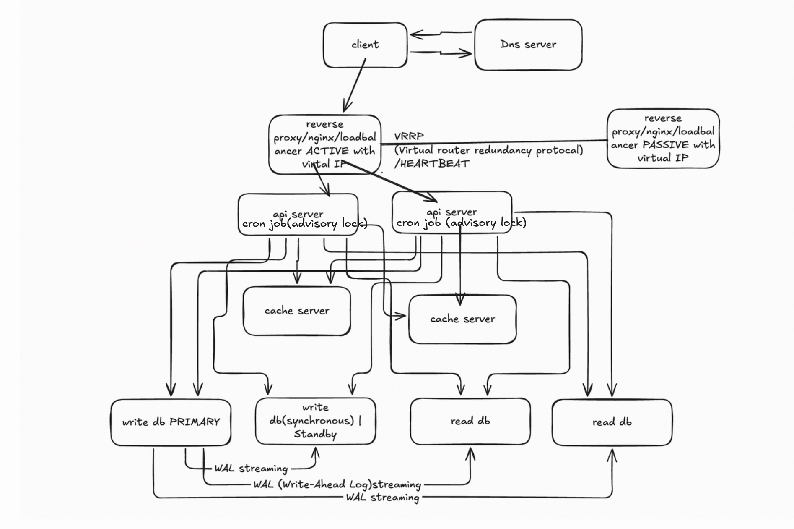

# URL Shortener — Phase 1

## 1. Requirements

**Functional**
- Create a short URL from a long URL
- Redirect a short URL to its long URL
- Fixed-length codes
- Links expire after 5 years

**Non-functional**
- Scale: 1M writes/month (peak 3×) · 10M reads/month (peak 10×) · not evenly distributed
- Availability 99.99%
- Latency p99 < 100 ms
- Eventual consistency is acceptable
- **Non-enumerable codes** — consecutive links must not get consecutive codes (no scraping by counting up/down, no leaking links/day) *(added 10 Nov)*

**Out of scope (Phase 1)**
- Sign-in · analytics

## 2. Back-of-the-envelope — traffic & scale
| | Calculation | Result |
|---|---|---|
| Writes (peak) | 1M × 3 / 2,592,000 s | ≈ 1.2 / s |
| Reads (peak) | 10M × 10 / 2,592,000 s | ≈ 39 / s |
| Rows over 5 years | 1M × 12 × 5 | 60M |
| Code length | 64⁴ = 16.7M < 60M · 64⁵ = 1.07B ≥ 60M | **5 chars** (scramble + fixed 5-char encode → every code is exactly 5) |

## 3. API

### Create a short URL
`POST /api/v1/urls`

Request body:
```json
{"long_url": "https://example.com/some/very/long/path"}
```

| Status | When | Response |
|---|---|---|
| `201 Created` | link created | body `{"short_url": "https://sho.rt/VsmKI"}` + header `Location: /VsmKI` |
| `422 Unprocessable Entity` | `long_url` missing or not a valid URL | `{"detail": "Invalid URL"}` |
| `429 Too Many Requests` | client over its rate limit | `{"detail": "Too many requests"}` |
| `500 Internal Server Error` | unexpected bug | `{"detail": "Internal error"}` |
| `503 Service Unavailable` | DB primary down (e.g. during failover) | `{"detail": "Server unavailable"}` |

### Redirect
`GET /{short_code}` — no body

| Status | When | Response |
|---|---|---|
| `302 Found` | code exists and not expired | header `Location: <long_url>` |
| `404 Not Found` | code invalid or doesn't exist | `{"detail": "Requested URL not found"}` |
| `410 Gone` | code existed but `expires_at` has passed | `{"detail": "Link expired"}` |
| `500` / `503` | bug / backend down | as above |

**Why 302 and not 301:** a 301 is cached by the browser forever, so repeat clicks never reach us — we lose control (can't expire the link) and later can't count clicks (Phase 2). A 302 sends every click back to us.

## 4. Data model — PostgreSQL

One table: **`urls`**

| Column | Type | Constraints | Notes |
|---|---|---|---|
| `id` | `BIGINT` | `PRIMARY KEY`, auto-increment (`BIGSERIAL`) | the counter; `short_code = encode(id)` |
| `long_url` | `TEXT` | `NOT NULL`, max 1,024 chars (checked in the API) | the redirect target |
| `expires_at` | `TIMESTAMPTZ` | `NOT NULL` | `created + 5 years`; used by redirect (`410`) and cleanup |

```sql
CREATE TABLE urls (
    id         BIGSERIAL PRIMARY KEY,
    long_url   TEXT        NOT NULL CHECK (length(long_url) <= 1024),
    expires_at TIMESTAMPTZ NOT NULL
);
-- no RESTART trick needed: the scramble + fixed 5-char encode makes every code 5 chars (10 Nov)
```

**`short_code` is not stored** — it's computed from `id` (encode) and back (decode), so no extra column and no extra index.
**Indexes:** only the PK. Redirect = PK lookup. Cleanup deletes by `id` range (lowest ids expire first), so no index on `expires_at` is needed.
**Duplicates:** the same long URL submitted twice gets two codes — fine for Phase 1 (no dedup index on `long_url`).

**Why Postgres:** access is pure key-value by PK, no joins · load is tiny (one primary handles it) · need an atomic counter (`BIGSERIAL`/`nextval()`) · mature replication + failover (WAL streaming, Patroni). Still Postgres at Phase 3 (no shard — see Phase 3); NoSQL (Cassandra) only for the click analytics there.

## 5. Back-of-the-envelope — storage (from the data model)
| | Calculation | Result |
|---|---|---|
| Row size | id 8 B + long_url 1,024 B (conservative; avg URL ~100 B) + expires_at 8 B | ≈ 1,040 B |
| Data | 60M × 1,040 B | ≈ 62 GB |
| PK index | 60M × ~32 B | ≈ 1.9 GB → fits in RAM |

**Why ~32 B per index entry** (Postgres B-tree): key `id` 8 B + index tuple header 8 B (6 B pointer to the row on disk + 2 B flags) + 4 B slot pointer in the page = **20 B**. Pages are only ~90% full, plus page headers and upper tree levels → round up to **~32 B** to be safe. (Rule of thumb: index entry ≈ key size + ~12–24 B overhead.)

**Why ~200 GB disk** (say: "about 100 GB used, provision 200 for headroom"):
| Step | Adds | Running total |
|---|---|---|
| Data + PK index | 62 GB + 2 GB | 64 GB |
| Bloat — deleted rows stay as dead rows until VACUUM (nightly cleanup creates many) | ~20–30% | ~80 GB |
| WAL — change log kept for crash recovery + replicas catching up (grows if a replica lags) | a few GB → tens of GB | ~100 GB used |
| Headroom — never run a DB disk near full | keep ≤ 50% full → × 2 | **~200 GB** |

Phase 3 (10× creates, 100× redirects) → `urls` grows ~10× (~690 GB data) → still one Postgres node; clicks move to Cassandra. See Phase 3.

## 6. High-level diagram




Client → LB pair (VRRP) → stateless API servers (nginx round-robin) → Redis (primary + replica, Sentinel failover) → Postgres primary + sync standby + async read replicas (Patroni + 3-node etcd). Cleanup cron on API servers.

## 7. Deep dives

### Key generation — counter + base-64, not hashing
Cutting any hash (MD5/SHA-256) to 5 chars causes collisions → needs check + retry. A DB counter converted to base-64 is unique by design.
(Not the `base64` library: it encodes bytes, pads with `=`, and can't give exactly 5 chars.)

**Problem: sequential ids → guessable codes.** Plain encode gives codes in order → anyone counts up/down → scrapes every link (private Doc links, invoices) + reads our volume. Redirects are public, so no auth check helps.
**Fix (10 Nov): scramble the id before encoding** — multiply by a secret odd number mod 64⁵, XOR a secret mask. 1-to-1 and reversible, codes look random, still exactly 5 chars.

```python
A   = "ABCDEFGHIJKLMNOPQRSTUVWXYZabcdefghijklmnopqrstuvwxyz0123456789-_"
POS = {c: i for i, c in enumerate(A)}
N   = 64**5                # 1,073,741,824 = 2^30 codes, all 5 chars
MUL = 387_420_489          # secret, must be ODD → has an inverse mod 2^30
INV = pow(MUL, -1, N)      # "undo" multiplier
XOR = 0x2A5F3C1            # secret mask (< 2^30)

def encode(i: int) -> str:             # i = id from the Postgres sequence (< N)
    n = ((i * MUL) % N) ^ XOR          # scramble
    chars = []
    for _ in range(5):                 # fixed 5 iterations → always 5 chars
        n, r = divmod(n, 64)
        chars.append(A[r])
    return "".join(reversed(chars))

def decode(s: str) -> int:
    n = 0
    for ch in s:
        n = n * 64 + POS[ch]           # KeyError → 404
    return ((n ^ XOR) * INV) % N       # unscramble: undo XOR, then undo multiply
```
Example (this code, tested 10 Nov): `1 → VsmKI`, `2 → sitFT`, `3 → H40Aa`, `600,000,000 → V8QXB` — all decode back exactly. (Shuffling `A` as well adds a bit more obfuscation.)
- **Why odd?** N = 2³⁰, so any odd number shares no factor with N → has an inverse → no two ids collide.
- **Limit:** only valid while `id < 64⁵` (1.07B). Beyond → 6-char codes with new N/constants; length tells decode which rule to use, old links keep working.
- **Why not Sqids?** Tried it: Sqids spends ~1 char on overhead → 600M ids need 6 chars. Scramble keeps 5.
- **Caveat:** obfuscation, not security (constants could be reverse-engineered from many samples). Truly sensitive links → random 7–8 char codes + unique constraint + retry.
- IDs are **never reused** (sequence only counts up; deleted/expired ids are never handed out again) — reuse would send old saved links to a stranger's URL.

### Request flow
- **Create:** `INSERT … RETURNING id` → `encode(id)` → write-through to cache → return short URL
- **Redirect:** `decode(code)` → cache → miss → read replica → miss → **primary** → still missing → 404
  (primary fallback = read-your-writes despite replication lag)

### Caching
Hot set is tiny (60M rows total, far less hot) → fits one Redis node → **1 primary + 1 replica, failover via Redis Sentinel** (rule from Phase 3: fits one node → Sentinel; doesn't fit → Cluster).
If it ever outgrows one node: don't route with `hash(key) % N` (N changes → most keys move → miss storm on DB) → **Redis Cluster**: 16,384 hash slots, the client library routes each key; adding a node moves only some slots.
Cache-aside: lazy refill on miss. A cache node down = misses, not data loss.

### Cleanup job (expired links)
- Nightly: delete where `expires_at < now()` (`expires_at` = created + 5 years).
- Never one big `DELETE` → WAL storm, replica lag, locks, bloat.
- Batches: one `DELETE` per 5k-id range → commit → sleep (~33k expire per night ≈ 7 queries).
- Start from `SELECT min(id)`: ids are sequential and lifetime is fixed, so expired rows = lowest ids.
- Better: partition by month → `DROP` the oldest partition.
- Redis: TTL = `expires_at` · redirect checks `expires_at` → `410`.
- One runner only: `pg_try_advisory_lock(42)` on all servers, or a K8s CronJob. Missing a night is OK (+ alert).
- Advisory lock beats a `job_running` flag: no race, auto-released if the process crashes.

### High availability
- **Load balancers:** active/passive pair sharing a virtual IP (VRRP heartbeat). Scale up → active-active + DNS round-robin.
- **API servers:** stateless → round-robin.
- **DB:** 1 primary + 1 synchronous standby + async read replicas, WAL streaming. Patroni on each DB node + separate 3-node etcd (majority vote, leader lease) → prevents split-brain. Failover ≈ 10–30 s write pause.
  Sequence may skip values after failover → gaps OK, never duplicates.

## 8. NFR walk-back

**Availability 99.99% (≈ 52 min/year)**
- 1 year = 525,600 min × 0.0001 ≈ 52.6 min. Each extra 9 = 10× less downtime (99.9% ≈ 8.8 h · 99.999% ≈ 5 min).
- **Series** (LB → API → DB): availabilities multiply; shortcut: add downtime % (99.99% + 99.95% → ≈ 99.94%).
- **Parallel** (redundant copies): failure chances multiply (two × 99.9% → 99.9999%).
- Availability = MTBF / (MTBF + MTTR) → fast repair (auto-failover) matters as much as rare failure.
- Every layer is redundant with automatic failover → a single failure costs seconds. I still promise only 99.99% because detection time, **bad deploys** (most real outages) and region/DNS outages eat the budget.
- To go higher: canary deploys + auto-rollback (biggest win) · faster health checks · multi-region · graceful degradation (DB down → keep serving redirects from cache; only "create" fails).
- Known limit: single region = no protection against a full DC outage.

**Latency p99 < 100 ms — latency budget**
| Hop | Time |
|---|---|
| User → DC (same continent) | 20–50 ms |
| LB + API code | 1–5 ms |
| Redis hit | ~1 ms |
| Postgres PK lookup (index in RAM) | 2–10 ms |

Cache hit ≈ 25–55 ms · miss ≈ 30–65 ms → fits. Breaks for other continents (Mumbai → Frankfurt ≈ 150 ms network alone).
Fix: read-only region in Asia (replica + Redis) — works *because* we accepted eventual consistency.

**No CDN for redirects (decided 9 Nov):** every redirect hits LB → API → Redis directly. Redis hit is ~1 ms, so a CDN saves only network distance, and it would cache the 302 → clicks stop reaching us → can't enforce expiry (`410`) or count clicks (Phase 2). Revisit only for global latency, with a short `max-age`.

**Eventual consistency**
Read replicas may lag briefly. Redirect falls back to the primary on a miss → a just-created link never 404s because of lag.

## 9. Doc fixes (what's wrong or missing in this file)

- [ ] Diagram: API servers draw arrows straight to the sync **standby** — writes should only hit the primary (standby takes over via Patroni).
- [ ] Diagram: the 2 cache servers are unlabelled and both API servers write to both → label them **primary / replica**, add a replication arrow + Sentinel (10 Nov decision).

## 10. Self-check (answer out loud without looking — tick when I can)
- [ ] Why 5 characters? (do the 64⁴ vs 64⁵ maths from memory)
- [ ] Peak writes/reads per second from 1M / 10M per month.
- [ ] Why does the PK index fit in RAM? (60M × ~32 B — and where 32 B comes from)
- [ ] Why counter + base-64 instead of hashing?
- [ ] Why scramble before encoding? Why must the multiplier be odd? What happens after id 64⁵?
- [ ] Why one Redis primary + replica (Sentinel) and not Redis Cluster here? Why does `hash(key) % N` break, and how do Cluster slots fix it?
- [ ] What is eventual consistency here, and why is it OK for a URL shortener? (replica lag → primary fallback)
- [ ] Why 302 and not 301? Why no CDN in front of redirects?
- [ ] How does the cleanup job delete 60M-scale data without hurting the DB, and why an advisory lock?
- [ ] How does failover work without split-brain? (Patroni + etcd)
- [ ] Why only 99.99% if every layer is redundant? Where does the 52 min come from?
- [ ] Walk the latency budget for a cache hit and a miss.
