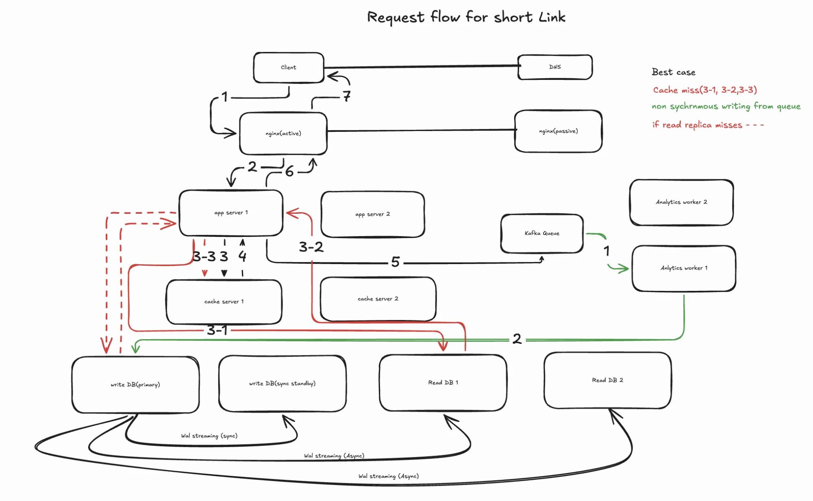

# URL Shortener — Phase 2

Builds on [Phase 1](phase-1.md). Only what changes or is added is written here.

## 1. Requirements

**Functional (new)**
- Sign up and sign in
- Create a short URL as a signed-in user, with a custom expiry date (optional)
- See all URLs I created
- Delete (cancel) my URLs
- Analytics per URL: clicks per day and per region, over a date range
- Anonymous create + redirect still work as in Phase 1

**Non-functional**
- Same as Phase 1: scale · 99.99% · p99 < 100 ms (same continent) · eventual consistency
- Redirect latency must NOT get worse because of analytics
- Analytics can be a few minutes behind (eventually consistent counts)
- Users can only see and delete their own URLs

**Out of scope (Phase 2)**
- Unique visitors · referrer / device analytics · SSO · teams / sharing

## 2. Back-of-the-envelope — traffic & scale
| Endpoint | Per month | Per second (avg) |
|---|---|---|
| Signups | 10k | ~0.004 |
| Logins | 100k | ~0.04 |
| Delete my URL | 10k | ~0.004 |
| List my URLs | 100k | ~0.04 |
| Analytics views | 100k | ~0.04 |
| Click events (= redirects) | 10M (peak 10×) | ≈ 39 / s peak |

Totals (peak): writes (1M × 3 + 100k × 3) / 2.59M s ≈ **1.3 / s** · reads (10M × 10 + 4 × 100k × 10) / 2.59M s ≈ **40 / s**.

→ Everything new is negligible next to redirects. The only real new load is **click events = every redirect becomes a write** (see deep dives).
Users over 5 years: 10k × 12 × 5 = **600k**. Only 10k signups vs 1M creates/month → most links are anonymous.

## 3. API

### Sign up
`POST /api/v1/signup` — form body `{email, password}`

| Status | When | Response |
|---|---|---|
| `201 Created` | user created | no body |
| `409 Conflict` | email already registered (DB unique violation) | `{"detail": "Email already exists"}` |
| `422` | missing field / not an email (Pydantic, before the DB) | FastAPI error |
| `429` | too many signups from one IP | `{"detail": "Too many requests"}` |
| `500` / `503` | as Phase 1 | |

### Sign in
`POST /api/v1/login` — form body `{email, password}`

| Status | When | Response |
|---|---|---|
| `200 OK` | credentials correct | `{"access_token": "<jwt>", "token_type": "bearer"}` |
| `401 Unauthorized` | wrong email or password | `{"detail": "Username or password is incorrect"}` |
| `422` | missing fields | `{"detail": "..."}` |
| `429` | too many attempts (brute-force protection) | `{"detail": "Too many requests"}` |
| `500` / `503` | bug / backend down | as Phase 1 |

### Create a short URL
`POST /api/v1/urls` — header `Authorization: Bearer <jwt>` (optional: anonymous still allowed)

```json
{"long_url": "https://example.com/...", "expires_at": "2027-12-31T00:00:00Z"}
```

| Status | When | Response |
|---|---|---|
| `201 Created` | link created | `{"short_url": "..."}` + `Location` header |
| `401` | token sent but invalid / expired | `{"detail": "Invalid or expired token"}` |
| `422` | invalid URL or `expires_at` in the past | `{"detail": "..."}` |
| `429` / `500` / `503` | as Phase 1 | |

### Redirect
`GET /{short_code}` — same as Phase 1, plus:

| Status | When |
|---|---|
| `410 Gone` | expired **or deleted** (`deleted_at` set) |

Side effect: emits a click event to the queue (see deep dives).

### Analytics
`GET /api/v1/urls/{short_code}/analytics?from=2026-12-22&to=2026-12-23` — header `Authorization: Bearer <jwt>`

```json
{
  "short_url": "...",
  "long_url": "...",
  "created_at": "2026-12-01T10:00:00Z",
  "clicks": [{"day": "2026-12-22", "region": "EU", "clicks": 42}]
}
```

| Status | When |
|---|---|
| `200 OK` | owner asks for their link |
| `401` | no / invalid / expired token |
| `403` | link belongs to someone else |
| `404` | code doesn't exist |
| `500` / `503` | as Phase 1 |

### List my URLs
`GET /api/v1/urls?page=1&limit=20` — header `Authorization: Bearer <jwt>`

| Status | When | Response |
|---|---|---|
| `200 OK` | always for a valid user (empty list if none) | `{"items": [{"short_url", "long_url", "created_at", "expires_at"}], "page": 1, "total": 57}` |
| `401` | no / invalid / expired token | `{"detail": "Invalid or expired token"}` |
| `500` / `503` | as Phase 1 | |

Query: `WHERE user_id = ? AND deleted_at IS NULL ORDER BY id DESC LIMIT 20 OFFSET …` — uses the `user_id` index. (Page/limit is fine at ~100s of links per user; cursor pagination only if lists get huge.)

### Delete my URL
`DELETE /api/v1/urls/{short_code}` — header `Authorization: Bearer <jwt>` · **owner only**

| Status | When | Response |
|---|---|---|
| `200 OK` | owner deletes their link | `{"detail": "url <short_code> deleted"}` (`204` no body is also common) |
| `401` | no / invalid / expired token | `{"detail": "Invalid or expired token"}` |
| `403 Forbidden` | link belongs to someone else | `{"detail": "Link belongs to someone else"}` |
| `404` | code doesn't exist — **also on a 2nd delete** (still idempotent: state doesn't change) | `{"detail": "link not found"}` |
| `500` / `503` | as Phase 1 | |

Behind it: `deleted_at = now()` on the primary → **evict the key from Redis**. Anonymous links (`user_id NULL`) can't be deleted — they just expire.

## 4. Data model — PostgreSQL

**`users`**
| Column | Type | Constraints | Notes |
|---|---|---|---|
| `id` | `BIGINT` | PK (`BIGSERIAL`) | |
| `email` | `VARCHAR(256)` | `UNIQUE NOT NULL` | login name |
| `password_hash` | `VARCHAR(256)` | `NOT NULL` | bcrypt/argon2 — never the plain password |
| `joined_at` | `TIMESTAMPTZ` | `NOT NULL` | |

**`urls`** (Phase 1 table + new columns)
| Column | Type | Constraints | Notes |
|---|---|---|---|
| `id` | `BIGINT` | PK (`BIGSERIAL`) | unchanged — `short_code = encode(id)` |
| `long_url` | `TEXT` | `NOT NULL`, ≤ 1,024 | unchanged |
| `created_at` | `TIMESTAMPTZ` | `NOT NULL` | **new** — shown in analytics |
| `expires_at` | `DATE` | `NOT NULL`, **indexed** | now user-chosen → see note below |
| `deleted_at` | `TIMESTAMPTZ` | `NULL` | **new** — soft delete |
| `user_id` | `BIGINT` | FK → `users.id`, `NULL`, **indexed** | **new** — `NULL` = anonymous; index for "list my URLs" |

**Why `expires_at` now needs an index:** in Phase 1 every link lived exactly 5 years, so the lowest ids expired first and cleanup deleted by id range. With custom expiry that's no longer true → cleanup must find rows by `expires_at`.

**`url_clicks_daily`**
| Column | Type | Constraints | Notes |
|---|---|---|---|
| `url_id` | `BIGINT` | FK → `urls.id` | |
| `day` | `DATE` | | |
| `region` | `CHAR(4)` | | e.g. `EU`, `IN` |
| `clicks` | `BIGINT` | `NOT NULL DEFAULT 0` | |

Composite PK `(url_id, day, region)` — also the index for "clicks of this URL between dates".

## 5. Back-of-the-envelope — storage
Rule: **index entry = key copy + ~24 B** (one index per PK / UNIQUE / indexed column, not per column).

**`users`** — 600k rows
- Row: id 8 + email 256 + password_hash 256 + joined_at 8 = 528 B
- Indexes: PK (8 + 24) + UNIQUE email (256 + 24) = 312 B
- Per user: 528 + 312 = 840 B → 840 × 600k ≈ **0.5 GB**

**`urls`** — 1M × 12 × 5 = 60M rows
- Row: id 8 + long_url 1,024 + created_at 8 + expires_at 4 (date) + deleted_at 8 + user_id 8 = 1,060 B
- Indexes: PK (8 + 24) + user_id (8 + 24) + expires_at (4 + 24) = 92 B
- Per URL: 1,060 + 92 = 1,152 B → 1,152 × 60M ≈ **69 GB**

**`url_clicks_daily`** — worst case every click is a new (url, day, region) row: 10M × 12 × 5 = 600M rows
- Row: url_id 8 + day 4 + region 4 + clicks 8 = 24 B
- Index: composite PK (8 + 4 + 4 = 16) + 24 = 40 B
- Per row: 24 + 40 = 64 B → 64 × 600M ≈ **38 GB** (real number lower: popular links share rows)

**Disk** = ((data + indexes) × 1.3 bloat + WAL) × 2 headroom
- Tables: 0.5 + 69 + 38 ≈ 108 GB
- (108 × 1.3 ≈ 140 + WAL ~10) × 2 ≈ **~300 GB per DB node** (each replica holds a full copy)

Interview line: "~110 GB of data over 5 years, provision ~300 GB per node — one Postgres primary still handles it."

## 6. High-level diagram
### Read flow (redirect)


*9 Nov 2026.* Black = cache hit · red = cache miss → read replica → app fills cache · red dashed = replica miss → primary fallback · green = Kafka → analytics workers → batched upsert into primary · WAL: sync to standby, async to read replicas.
- [ ] Write flow (create / signup / delete) diagram.

## 7. Deep dives

### Analytics — every read becomes a write
- Don't write to Postgres inside the redirect: 39 writes/s on the hot path, and redirect latency would depend on the DB.
- Redirect → emit click event to a **queue** (fire-and-forget) → **worker** aggregates in memory → every few seconds upsert:
  `INSERT … ON CONFLICT (url_id, day, region) DO UPDATE SET clicks = url_clicks_daily.clicks + EXCLUDED.clicks`
- Batching = few DB writes, and counts are a few seconds/minutes behind (accepted in NFRs).
- No CDN in front of redirects (Phase 1 decision) → every click reaches us → nothing is invisible.
- [ ] Region: from GeoIP lookup on the client IP.
- Queue = **Kafka**: durable log (clicks survive a worker crash), consumer group → workers scale by adding partitions, no LB needed (workers pull). Redis Streams = lighter alternative at this scale.

### Auth
- JWT = **who you are (authN)**, not **what you can access (authZ)**.
- Ownership check on every "my URL" endpoint: `url.user_id == current_user.id`, else `403`. Without it → IDOR: anyone can read anyone's analytics by guessing codes (codes are sequential!).

### Delete
- Soft delete (`deleted_at = now()`) → redirect returns `410`.
- **Evict the cache** on delete, else the deleted link keeps redirecting from Redis.

## 8. NFR walk-back
- **Redirect latency:** queue publish is fire-and-forget (~1 ms) → p99 unchanged.
- **Queue down:** redirect still works; clicks are lost or buffered locally. Analytics is less critical than redirects.
- [ ] TODO: availability of auth (login down ≠ redirects down).

## 9. Doc fixes (what's wrong or missing in this file)
- [x] Signup endpoint (9 Nov) — own email/password; SSO out of scope
- [x] DELETE endpoint (9 Nov)
- [x] List my URLs — page/limit (9 Nov)
- [ ] Rate limiter behind the `429`s → covered properly in D5 (token bucket in Redis, per IP / per user)
- [x] Path naming → `/api/v1/urls` everywhere (Phase 1 updated 9 Nov)
- [x] Back-of-the-envelope: traffic + storage for all tables (9 Nov)
- [ ] Diagram: read flow ✅ (9 Nov) · write flow still TODO

## 10. Self-check (answer out loud without looking — tick when I can)
- [ ] Why does analytics turn reads into writes, and why not write to Postgres in the redirect?
- [ ] Walk the click path: redirect → queue → worker → upsert. What does `ON CONFLICT` do?
- [ ] What happens to redirects if the queue is down?
- [ ] AuthN vs authZ — what is IDOR, and why is it worse with sequential codes?
- [ ] Why soft delete, and why must delete evict the cache?
- [ ] Why does `expires_at` need an index now when Phase 1 didn't?
- [ ] 409 vs 422 · 401 vs 403 — when each?
- [ ] Why no CDN — and how does that help analytics?
