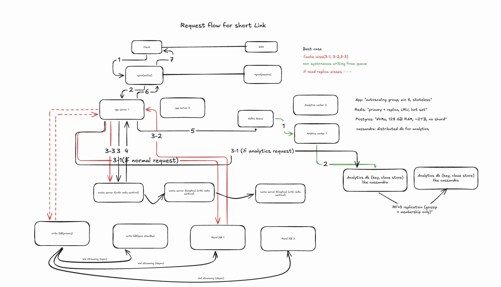

# URL Shortener — Phase 3

Builds on [Phase 2](phase-2.md). Same 7 endpoints, 100× reads / 10× everything else.

## 1. Requirements
**Functional:** same as Phase 2 (anonymous create + redirect still work).

**Scale**
- 1,000,000,000 redirects / month (peak 10×)
- 10,000,000 creates / month (peak 3×)
- Signup 100,000 · Login 1,000,000 · Delete 100,000 · List 1,000,000 · Analytics 1,000,000 / month

**Non-functional:** same as Phase 2.

## 2. Back-of-the-envelope — traffic & scale
```
All the other endpoints have ≤ 1,000,000 requests / month
Reads (login + list + analytics): 3 × 1,000,000 × 10 peak = 30,000,000
Writes (signup + delete): 2 × 100,000 × 3 peak = 600,000

Total writes => (10,000,000 × 3 + 600,000) / 2,592,000 = 30,600,000 / 2,592,000 ≈ 12 writes/s
Total reads  => (1,000,000,000 × 10 + 30,000,000) / 2,592,000 = 10,030,000,000 / 2,592,000 ≈ 3,870 reads/s
```
Read-heavy ~300:1. Code length: 600M rows over 5 years → 64⁵ = 1.07B ≥ 600M → **still 5 chars** (tight; ~10 years → 6).

## 5. Back-of-the-envelope — storage
```
Rule: index entry = key copy + 24B (one per index, not per column)

User table (100,000 × 12 × 5 = 6,000,000 rows)
Per user = 528 + 312 = 840B → 840 × 6,000,000 ≈ 5GB

Url table (10,000,000 × 12 × 5 = 600,000,000 rows)
Per url = 1060 + 92 = 1152B → 1152 × 600,000,000 ≈ 690GB

Url clicks daily (worst case: 1,000,000,000 × 12 × 5 = 60,000,000,000 rows)
Per row = 24 + 40 = 64B → 64 × 60,000,000,000 ≈ 3.8TB

All tables ≈ 4.5TB
Disk = (4,535 × 1.3 + 50) × 2 ≈ 12TB per DB node
```
Interview line: "~4.5 TB over 5 years, ~12 TB disk per node with headroom — fits one NVMe box, so scale vertically + replicas; split clicks (85%) into an analytics store for isolation; shard only when growth outruns one box."
_(Corrected 10 Nov: 12TB = disk NEEDED per node, not a node limit. Disk is the easiest limit.)_

## 6. High-level diagram
### Read flow (redirect) + analytics


*10 Nov 2026.* Same as [Phase 2 read flow](phase-2-read-flow.png) plus: Nginx **active/passive** · app autoscaling (min 6) · Redis primary + replicas, failover via **Sentinel ×3** (one per Redis box) · analytics worker writes to **Cassandra** (RF=3), not Postgres · analytics endpoint (3-1) reads from Cassandra · Postgres: primary + sync standby + async read replicas, no shard.
Known nits: replicas drawn chained (cache1→2→3) — normally both replicate from the primary · Nginx → app server 2 arrow missing.

## 7. Deep dives

### Shrink before you shard (9 Nov)
1. **Move clicks out of Postgres** → append-only analytics store (ClickHouse / Cassandra) + roll old days up into monthly totals → Postgres ≈ 690GB data → **~2TB per node**.
2. **Then:** does `urls` need sharding? 2TB on one node is manageable, writes are 12/s, cache absorbs most of 3,870 reads/s → **not yet**, it's the next step as data grows.

### Scaling each stop (10 Nov)
**Nginx** — event-driven, fixed workers (≈1 per core): CPU rises with load, memory barely (few KB/conn). 4k req/s is light → run **2 for redundancy, not capacity**.
- t2/t3 = **burstable** (baseline ~10% vCPU + credits → throttled under steady load). Steady load → **c/m family** (full CPU always).
- **How to know:** load test (wrk/k6) 10+ min, ramp up; watch p99, errors, CPU, CPUCreditBalance. Capacity = just before the p99 knee. Size for ~50–60% CPU at peak.

**App servers** — **stateless**, autoscaling group.
- **Scale on load** (req/instance or CPU ~60%), **alert on p99 latency**, then find the bottleneck. URL shortener is I/O-bound → CPU can look fine while latency climbs. Slow DB + more app servers = worse.
- Sizing: 1 box ≈ 1k req/s (from load test) → 4 + headroom = **min 6**. Scale-out takes minutes → keep the minimum high.

**Cache (Redis)** — cache the **hot set**, not all data (80/20). 1 node = 100k+ ops/s; hot set ~tens of GB → **1 primary + 1 replica, LRU**. Shard (Redis Cluster) only when the hot set > one node's RAM.
- Redis Cluster routing: `slot = CRC16(key) % 16384`, slots → nodes. **Client library** (redis-py `RedisCluster`) caches the slot map, goes straight to the node; stale → `MOVED`. Adding a node = move slots, keys never change slot. Avoids the `hash % N` remap problem (same idea as consistent hashing).

- **Replica vs shard:** cache 2 = **full copy** of cache 1 (replica, for failover) — NOT half the keys. Sharded = each node holds part of the slots, and then each shard needs its own replica (2 shards = 4 boxes).
- **Who switches to the replica? Redis Sentinel** — separate small process (`redis-sentinel`), run **3** (odd → vote). Ping primary → 2 of 3 agree it's down → promote replica → app (redis-py via Sentinel) asks "who's primary?" and follows.
  - Placement: 1 on each Redis box + 1 on a **stable third machine**. Not on app servers (autoscaling → voters disappear). Not all on Redis boxes (primary box dies → its Sentinel dies too).
- **Rule: fits one node → Sentinel (primary + replicas). Doesn't fit → Redis Cluster (sharding + failover built in).** Never both. Managed: ElastiCache does failover behind a DNS endpoint. Postgres equivalent: **Patroni**.

**Analytics store — Cassandra** (clicks, not URLs)
- Fits: write-heavy, append-only, fixed query "clicks for MY url by day/region" → partition key `url_id`, clustering key `day` → one partition per query. ClickHouse instead if we need ad-hoc cross-link aggregations (Cassandra is bad at queries not starting from the partition key).
- **Distributed by default:** no primary (peer-to-peer) · token ring = consistent hashing on partition key · RF=3 · tunable consistency (`ONE` / `QUORUM`) · add a node → auto-rebalance.
- **How nodes talk:** **gossip** = membership only (every second, 1–3 random peers swap who's up / who owns which ranges). **Data** = client → any node becomes **coordinator** → hashes key → sends to the RF replicas directly (TCP) → waits for CL acks. Replica down → **hinted handoff**.
- Interview line: *"Cassandra, RF=3, partitioned by url_id, writes at ONE — a lost click is acceptable."*

**DB** — plain Postgres has **no built-in sharding** (psycopg = one server). If ever needed: app-level routing (DIY) · sharding layer (**Citus** / Vitess) · natively distributed (**DynamoDB / Cassandra**, partition key = short_code).
- **What limits one node:** disk (easy, add drives) · **RAM** (hot indexes must fit; ~1–4TB slot cap) · **IOPS** (HDD ~150, SATA SSD ~50–100k, NVMe ~500k–1M+; raise via NVMe / RAID 10 / more RAM) · **ops** (restore/replica rebuild time).
- **RAM = working set, not total data.** Index lookup gives the page; the row read is RAM (~0.1µs) or disk (~100µs, 1000×). Redis absorbs hot reads → DB RAM ≈ `short_code` index (600M × (5+24)B ≈ **17GB**) + buffer for misses / **cold cache after Redis restart** / writes → **~64GB, 128GB comfortable**.
- **Conclusion:** 4.5TB on one NVMe box, 12 writes/s → **no shard. Vertical + read replicas** (failover in seconds, no multi-hour restore). Clicks → analytics store for **workload isolation**.

### When to shard — and how (10 Nov)
**Reasons to shard** (only when shrink + vertical + replicas run out):
1. **Storage** — data (+ headroom) outgrows the biggest practical box.
2. **RAM** — hot indexes no longer fit → reads hit disk, p99 jumps.
3. **Write throughput** — one primary can't take the writes (replicas only scale *reads*).
4. **Blast radius / recovery time** — replicas cover *hardware* failure (failover in seconds). They do NOT cover *logical* failures: a bad migration or `DELETE` without `WHERE` is replicated instantly → restore from backup (10TB = hours). Also after failover you have no spare until a new replica is copied (hours at 10TB). Sharding → a mistake hits 1/N users and each restore/rebuild is N× smaller. Weak reason at 4.5TB.
5. **Data locality / compliance** — e.g. EU users' data must stay in the EU.
> Not a reason: high read traffic → cache + read replicas first.

**How to handle it once shards exist:**
1. **Pick the shard key from the main query.** Redirect = `WHERE short_code = ?` → **`hash(short_code)`** → every redirect hits exactly one shard, even spread.
   - Risk: **range** sharding on sequential codes/IDs → all new writes land on the last shard (hot shard). Hash avoids it.
   - Hot *key* (one viral link) → Redis absorbs it, not the shard.
2. **Routing** — Citus / Vitess coordinator, or a distributed DB (DynamoDB / Cassandra, partition key = `short_code`). DIY app routing only if forced.
3. **Cross-shard queries** — "list my URLs" (`WHERE user_id = ?`) now hits every shard (scatter-gather). Fix: a second table `user_urls` sharded by `user_id` (denormalised lookup), or accept scatter-gather for a rare endpoint.
4. **IDs / uniqueness** — no single sequence across shards → hash of code, or range allocation per server (ties to the open ID item).
5. **Resharding** — start with many **logical shards** (e.g. 256) on few physical nodes; grow by moving logical shards, never `hash % N` on physical nodes (= remap everything). Same idea as Redis slots.
6. **Each shard = primary + replica**, otherwise sharding multiplies failure points.
7. **Joins / transactions** — keep what's read together on the same shard (co-locate by key); avoid cross-shard transactions.

Interview line: *"I shard when storage, RAM or write load outgrow one node — not for reads. Key = hash(short_code) for even spread and single-shard redirects; 'list my URLs' gets a user_id-keyed lookup table; logical shards so growth is moving shards, not rehashing."*

### ID generation (10 Nov)
- **Phase 3 = keep the Postgres sequence** (`INSERT … RETURNING id` → encode). 12 writes/s on one primary, no shard → one central counter is fine.
- **Problem: sequential codes are guessable (enumeration).** id 1,000,000 → `4c92`, next → `4c93`… Anyone can count up/down → scrape every link (private Doc links, invoices) + read our volume (links/day). Ownership check only guards analytics — **redirects are public by design**.
- **Decision: Sqids** — encode the id with a **custom shuffled alphabet** (kept private) → consecutive ids give random-looking codes, still 1-to-1 and decodable, no extra DB lookup.
  - Caveat: Sqids is **obfuscation, not security** (no secret salt; Sqids docs say don't use for sensitive data). If links must be truly unguessable → random 7–8 char codes + unique constraint, retry on collision.
- **If sharded / multi-primary later:** no single sequence → **range allocation** (each app server takes a block of 1,000 ids from a small counter service, one DB hit per 1,000 links) or Snowflake-style ids (timestamp + machine + counter, no coordination, but longer codes).
- Interview line: *"Postgres sequence for uniqueness, Sqids with a shuffled alphabet so codes aren't enumerable; random codes if links are sensitive; range allocation once sharded."*

## Open (continue 10 Nov)
- [x] Shard key for `urls` if we do shard — hash(short_code); not needed at Phase 3 scale (see "When to shard") (id? hash? range?) · consistent hashing
- [x] ID generation — sequence + Sqids; range allocation if sharded
- [x] Cache at 3,870 reads/s: 1 primary + replica, LRU on hot set (hit ratio TBD)
- [ ] Multi-region? → parked to later list
- [x] Phase 3 diagram (10 Nov, read flow)
