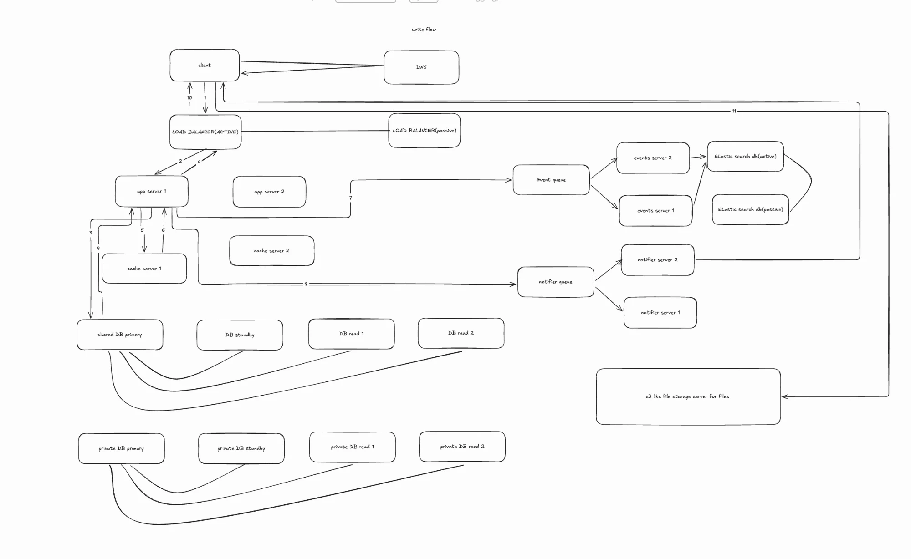
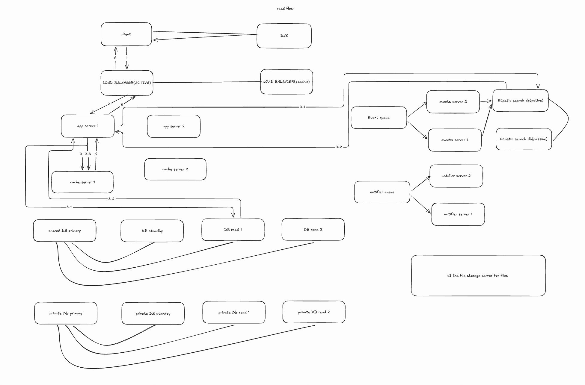

# D2 — Jira-like multi-tenant B2B SaaS — Phase 1

Sessions: 12 Nov (requirements, data model) · 15 Nov (storage, RAM) · 16 Nov (diagrams, cache consistency, attachments, API, deep dives, NFR walk-back).
Drafted in `practice.txt`, cleaned up here.

## 1. Requirements

**Clarifying questions I asked:** how many tenants / users per tenant · compliance (separate DBs, deletion) · traffic per user · 5-year growth.

**Functional**
- Many companies (tenants) share the product; each sees only its own data.
- Create / read / edit / delete tickets; each ticket has a state, assignee, priority.
- Tickets have types, a hierarchy (epic → story → sub-task) and belong to projects.
- Users with permission levels via groups; tenant admins add users (invite flow).
- Login required for everything.
- Audit trail for every change; comments; attachments.
- Search (full text) and filter lists.

**Non-functional**
- **Consistency split:** STRONG for ticket writes, status changes, audit log · READ-YOUR-WRITES for the author · EVENTUAL for search, dashboards, notifications.
- **Availability 99.99 %** (~52 min/year).
- **Latency p99 < 100 ms** for API calls within the EU (search p99 < 300 ms).
- **Data integrity:** no lost or conflicting writes.
- **Isolation:** 2 bank tenants get their own database by contract; everyone else shares.
- **GDPR:** all data stays in the EU.
- **Deletion:** a leaving tenant's data is gone within 30 days.
- Scale today: 2,000 tenants · 300k users · 100k DAU · 50M tickets (+10M/year) · tenants 10–100 users, biggest 5,000.
- Per user per day: 50 reads · 5 writes · 5 searches.
- 5-year growth: 15,000 tenants · 2M users · 700k DAU · 250M tickets.

**Out of scope:** tenant data export · deletion pipeline details (backups, legal holds) · rate-limiter design (→ D5) · billing · SSO details.

**Insight to say out loud:** the scale is small — the hard part is **tenancy** (isolation, bank DBs, noisy neighbours, 30-day deletion).

## 2. Back-of-the-envelope — traffic

| | Calculation | Result |
|---|---|---|
| Reads | 700k DAU × 50 / 12 h / 3600 × 10 (spikes) | **~8,000 req/s** |
| Writes | 700k DAU × 5 / 12 h / 3600 × 5 (spikes) | **~400 req/s** |

- **Writes are expensive and can't be spread out.** Every write must (1) fsync the WAL to disk
  so it survives a crash, (2) update every index on the table, (3) lock the rows it changes.
  Only the **primary** accepts writes, so you can't add machines to get more write capacity.
  → We need ~400 writes/s; one Postgres primary handles ~1–5k/s → **one primary per bank is plenty.**
- **Reads are cheap and can be copied.** A read is served from RAM (cached pages), and thanks to
  MVCC snapshots readers never wait for writers. Any copy of the data can answer a read.
  → We need ~8,000 reads/s; one Postgres does ~10k+/s, which is too tight with spikes
  → **scale out:** read replicas + Redis cache in front (Redis ~100k ops/s, from RAM).
- Rules of thumb (one ordinary server): Postgres ~1–5k writes/s · ~10k+ reads/s · Redis ~100k ops/s.

## 3. API

**Common rules** (all endpoints except login)
- Prefix `/api/v1` · header `Authorization: Bearer <jwt>`.
- `tenant_id`, `user_id`, permissions come **from the JWT** — never from path or body.
- Every query adds `WHERE tenant_id = <from jwt>`.
- Another tenant's object → **404, not 403** (don't reveal it exists).
- Lists: **cursor pagination** `?limit=50&cursor=<opaque>` → `{items, next_cursor}`.
- Errors: 401 no/expired token · 403 not allowed · 404 · 409 conflict · 422 validation · 429 per-tenant rate limit · 500/503.

**Auth**
| Endpoint | Body | Success | Failures |
|---|---|---|---|
| `POST /auth/login` | `{email, password}` | 200 `{access_token (15 min), refresh_token}` | 401 wrong credentials · 429 |
| `POST /auth/refresh` | `{refresh_token}` | 200 new access token | 401 expired/revoked |
| `POST /auth/accept-invite` | `{invite_token, password}` | 200 tokens | 410 expired/used |
| `POST /users/me/password` | `{old_password, new_password}` (user from JWT) | 200 new `{access_token, refresh_token}` — **revokes all other refresh tokens** (bump `token_version`); a stolen access token still works ≤15 min (JWT is signed with the server key, not the password) | 401 bad token · 403 wrong old password · 422 weak / same as old · 429 |

**Tenants** (signup / platform admin)
| Endpoint | Body | Success | Failures |
|---|---|---|---|
| `POST /tenants` | `{name, plan, isolated, admin_email}` | 201 `{tenant_id}` · 202 if a private DB must be provisioned | 409 name taken |
| `GET /tenants/me` | — | 200 `{tenant_id, name, plan}` | |
| `DELETE /tenants/me` | — (tenant admin) | 202 `{deletion_due: +30 d}` | 403 |

**Users · groups · projects**
| Endpoint | Body | Success | Failures |
|---|---|---|---|
| `POST /users` | `{email, name, position, group_ids}` (admin) | 201 — invite email sent | 409 email exists · 403 |
| `GET /users?group_id=&cursor=` | — | 200 list | |
| `GET /users/{id}` · `PATCH /users/{id}` | `{name?, position?}` | 200 | 404 |
| `DELETE /users/{id}` | — (admin) | 204 soft delete | 403 |
| `POST /groups` · `GET /groups` | `{name, permissions}` | 201 / 200 | 409 name exists |
| `POST /groups/{id}/members` | `{user_id}` | 204 | 404 · 409 already member |
| `DELETE /groups/{id}/members/{user_id}` | — | 204 | 409 last tenant admin |
| `DELETE /groups/{id}` | — | 204 | 409 still has members |
| `POST /projects` · `GET /projects?cursor=` | `{key: "PAY", name}` | 201 / 200 | 409 key taken |

**Tickets**
| Endpoint | Body / params | Success | Failures |
|---|---|---|---|
| `POST /tickets` | `{project_id, type, title, description, parent_id?, assignee_id?, priority?}` | 201 `{id, key: "PAY-123", version: 1}` + `Location` | 404 project · 422 |
| `GET /tickets/{id}` | — | 200 full ticket incl. `version` (cache-aside) | 404 |
| `GET /tickets?project_id=&status=&assignee_id=&type=&parent_id=&sort=-created_at&limit=50&cursor=` | filters | 200 `{items, next_cursor}` — Postgres | 422 |
| `GET /search?q=&project_id=&cursor=` | full text | 200 `{items, next_cursor}` — Elasticsearch, few s behind | |
| `PATCH /tickets/{id}` | header `If-Match: <version>` · only changed fields | 200 full ticket, `version + 1` | **409 version mismatch** · 422 invalid status transition |
| `DELETE /tickets/{id}` | — | 204 soft delete | 404 |

**Comments · attachments · audit log**
| Endpoint | Body | Success | Failures |
|---|---|---|---|
| `POST /tickets/{id}/comments` | `{content}` | 201 (@mentions → notifier) | 404 |
| `GET /tickets/{id}/comments?cursor=` | — | 200 oldest first | |
| `PATCH` / `DELETE /comments/{id}` | `{content}` | 200 / 204 | 403 not author/admin |
| `POST /tickets/{id}/attachments` | `{filename, size, content_type}` | 201 `{attachment_id, upload_url, expires_in: 300}` (row pending) | 413 · 415 |
| `PUT <upload_url>` | file bytes → S3 directly | 200 | 403 signature/expired |
| `POST /attachments/{id}/complete` | — | 200 `{status: uploaded}` | 409 object not in S3 |
| `GET /attachments/{id}` | — | 302 → pre-signed GET URL | |
| `GET /tickets/{id}/logs?cursor=` | — | 200 `{user, event, old, new, timestamp}` — read-only | |

## 4. Data model — PostgreSQL

Same schema in every DB bank. Shared bank = most tenants; private bank = the 2 bank tenants. **`tenant_id` on every table.**

```
tenants:      id 8 PK · name 20 · is_shared 1 · db_name 20 · plan 10 · deleted_at 8
users:        id 8 PK · tenant_id 8 · name 20 · email 50 · position 20 · permissions_json 1K
              · status 10 (invited/active/deactivated) · invite_token_hash 32 · invite_expires_at 8 · deleted_at 8
              idx: UNIQUE (tenant_id, email) · (name)
user_groups:  user_id 8 · group_id 8 · tenant_id 8      PK (user_id, group_id) · idx (tenant_id, group_id)
groups:       id 8 PK · tenant_id 8 · group_name 20 · permissions_json 1K      idx (tenant_id, group_name)
projects:     id 8 PK · tenant_id 8 · key 10 · name 50 · created_at 8          UNIQUE (tenant_id, key)
tickets:      id 8 PK · tenant_id 8 · project_id 8 · key 12 · author 8 · assignee_id 8 · title 256 · type 20
              · status 20 · priority 10 · description 1K · parent_id 8 · version 4
              · created_at 8 · updated_at 8 · deleted_at 8
              idx: (tenant_id, project_id, created_at) · (tenant_id, assignee_id, status) · (parent_id) · (author)
comments:     id 8 PK · tenant_id 8 · ticket_id 8 · user_id 8 · timestamp 8 · content 1K · links_path 32 · parent_comment_id 8
              idx: (tenant_id, ticket_id, timestamp) · (tenant_id, user_id)
logs:         id 8 PK · tenant_id 8 · ticket_id 8 · user_id 8 · timestamp 8 · event 20 · old_value ~30 · new_value ~30
              idx: (tenant_id, timestamp) · (ticket_id)            — partitioned by month
attachments:  id 8 PK · tenant_id 8 · ticket_id 8 · uploader_id 8 · filename 100 · s3_key 100 · size 8
              · content_type 30 · status 10 (pending/uploaded) · created_at 8      idx (tenant_id, ticket_id)
```

**Why these choices**
- `comments` = own table, one row per comment (not a JSON column in tickets): appending to JSON = read → append → write back → two people at once = **lost update**; 500 comments → every comment rewrites the whole row. *Analogy: one shared notebook everyone takes home and rewrites vs. everyone sticks their own sticky note.*
- `parent_id` only (children = `WHERE parent_id = X`), not parent + child columns.
- `user_groups` join table: a user can be in many groups.
- `version` only on tickets (cached + updated). Not on append-only tables.
- Indexes built per real query (filter columns first, sort column last); no plain `tenant_id` index where a composite starts with it. Every index slows every write.
- Mixed tenancy: `is_shared` + `db_name` in `tenants` = routing to a private DB.
- Soft deletes (`deleted_at`) keep authorship + audit intact.

### Composite index — not only "WHERE a = x AND b = y"
**Phone book sorted by (surname, first name):**
| Query | Uses the index? |
|---|---|
| surname = Kumar AND first name = Rahul | ✅ filter + filter |
| surname = Kumar | ✅ **leftmost prefix** |
| surname = Kumar ORDER BY first name | ✅ filter + sort, no sort step |
| first name = Rahul only | ❌ Rahuls are scattered |

- A query usually uses **one** index → build it to match the whole query.
- `(tenant_id, id)` doesn't speed up lookup by `id` — `WHERE tenant_id` is there for **safety**. It can **replace** a plain `tenant_id` index.

## 5. Back-of-the-envelope — storage

Rule: row size + index entries (each entry ≈ key + ~24 B) → × rows.
Assumptions (5 years): 250M tickets · 3 comments/ticket · 10 changes/ticket · 1 attachment per 5 tickets.

| Table | Rows | Row + indexes | Total |
|---|---|---|---|
| tickets | 250M | 1,418 + 204 = 1,622 B | **~405 GB** |
| comments | 750M | 1,104 + 120 = 1,224 B | **~918 GB** |
| logs | 2.5B | 120 + 104 = 224 B | **~560 GB** |
| attachments (rows only) | 50M | 288 + 72 = 360 B | ~18 GB |
| users · user_groups · groups · projects · tenants | — | — | ~3.5 GB → ignore |

- **Total ≈ 1.9 TB** → × 1.3 (bloat + WAL) → × 2 headroom ≈ **5 TB SSD per DB node**.
- Attachment **files** live in S3: 50M × ~500 KB ≈ **25 TB** — that's why files never go into Postgres.
- Comments dominate (1 KB text is conservative). Logs = most rows, indexes ~2× the data → partition by month, old months → cold storage.

**RAM** = (indexes, or their hot part) + hot data pages + WAL/connections → × 2.
| Part | Size |
|---|---|
| Hot set: last month — 4.2M tickets (6.8 GB) + 12.5M comments (15.3 GB) + 42M logs (9.3 GB) | ~32 GB |
| B-tree upper levels (~1 % of 405 GB of indexes) | ~4 GB |
| WAL buffers + connections + OS | ~3 GB |
| **Minimum** | **~40 GB** |
| **Provision (× 2, round up)** | **128 GB** (64 = no headroom) |

**Say it:** *"SSD for everything, RAM for what's hot, × 2. Data is 1.9 TB, indexes ~400 GB, neither fits in RAM. The working set is last month, about 32 GB, plus B-tree tops and WAL → 40 GB minimum, I'd provision 128."*

## 6. High-level diagram

### Write flow


### Read flow


Boxes: DNS · LB (active/passive) · app ×2+ (JWT dependency + in-memory tenant directory) · auth service (issues tokens only) · Redis ×2 ·
event topic → indexer ×2 → Elasticsearch · notifier ×2 → SES / websocket · shared DB bank + private DB bank (primary / sync standby / 2 read replicas each) ·
S3 (attachments, backups) · second EU region (warm standby).

**Write:** client → LB → app → primary (UPDATE ticket + INSERT audit, one transaction) → cache CAS-SET → publish event → 200.
**Read:** app → cache hit? return : read replica → cache SET with TTL → return. Cache and DB never talk to each other.
**Search:** `GET /search` → Elasticsearch (fed async by the indexer), always filtered by `tenant_id`.

## 7. Deep dives

### 7.1 Version number — why and how
**Why (three problems, one column):**
- **Cache race:** server A writes v7, server B writes v8. Their cache SETs can arrive v8 then v7 → cache stuck on old data. The DB orders DB writes; nothing orders cache writes across servers.
- **Lost update:** two users save the whole form → the second silently wipes the first.
- **Instant read-your-writes** without routing the author to the primary.
- Not timestamps: app-server clocks drift (clock skew). The DB's version is ordered by the DB itself.

**How:**
```sql
UPDATE tickets SET status = 'done', version = version + 1
WHERE id = 42 AND tenant_id = 7 AND version = 7      -- If-Match: 7
RETURNING *;
```
- 0 rows → someone else changed it → **409** = **optimistic locking** (no lock held while the user edits).
- Same transaction: INSERT audit row (old → new).
- Cache: Redis Lua **compare-and-set** — write only if new version > cached version.
- Response = the RETURNING row → author sees it instantly.
- Two users change **different fields** at once: partial UPDATEs → row lock runs them one after another, both survive; RETURNING gives the merged row, higher version wins in the cache. Danger only if the app does read → modify → write of the whole row.

**Two consistent packages — don't mix them:**
| | A: DELETE on write | B: SET with version (**chosen for tickets**) |
|---|---|---|
| Write | UPDATE → DELETE cache key | partial UPDATE … RETURNING * → cache CAS-SET |
| Author sees own write | author's reads → primary for ~1–2 s (else a lagging replica re-caches the old row) | instantly from cache |
| Extra column | none | `version` on tickets |

Alternatives: Postgres `xmin` (change detection only, wraps around) · CDC / Debezium (one ordered WAL reader updates the cache, LSN = version).
Names: eventual consistency for others · read-your-writes for the author · compare-and-set on the cache · optimistic locking in the DB. Strong consistency (linearizability) = every read from the primary = no read scaling.

### 7.2 Auth + tenant routing
- **Auth service only issues tokens** (login, invite, refresh; holds the private key).
- **Every app server checks the JWT itself**, as a dependency before every endpoint (FastAPI `Depends` / Django middleware):
  1. verify signature locally with the public key (RS256) + expiry → 401. No network call.
  2. read `tenant_id`, `user_id`, permissions from the claims.
  3. **tenant directory** (in memory, 15k × ~100 B ≈ 1.5 MB, from the control plane) → shared or private bank → that bank's connection pool (primary for writes, replica for reads).
  4. pass tenant + DB session into the endpoint → every query `WHERE tenant_id = …`.
- Cache keys prefixed `t:{tenant_id}:ticket:{id}`; search filtered by `tenant_id`.
- Alternative: API gateway validates the JWT at the edge — app still does tenant routing.

### 7.3 Onboarding + roles (admin = a group, Jira-style)
- `POST /tenants` → tenant + default groups (`tenant-admins`, `members`) + first user in `tenant-admins`.
- Admin invites (`POST /users`) → `status = invited` + hashed one-time token, 7 days → user accepts → `active` → JWT.
- Three levels: platform admin (us) · tenant admin · member (group permissions per project).
- Groups, not a role column: one permission model; several admins are easy.
- Guard: removing the **last** tenant admin → 409.
- Permissions go into the JWT at login → changes apply at refresh (≤ 15 min); instant revoke → Redis denylist.

### 7.4 Audit log ≠ event queue
- Audit = legal record → INSERT in the **same transaction** (sync, no extra hardware, cost = storage).
- Event queue = transport for side jobs (indexer, notifier) → async; lost messages can be rebuilt from the DB.
- One topic + 2 consumer groups (indexer, notifier), not two publishes. To never lose an event after commit → **outbox table** (open).

### 7.5 Attachments — client → S3 directly
- Never stream files through app servers (double bandwidth, workers blocked for minutes, LB timeouts).
- **Pre-signed URL** = app signs locally (HMAC-SHA256 over method + bucket/key + expiry). No AWS call, nothing registered. S3 recomputes it from the `X-Amz-*` params; any change → 403. Can't exceed the signer's IAM permissions.
  `s3.generate_presigned_url("put_object", Params={"Bucket": b, "Key": k}, ExpiresIn=300)`
- Cleanup: `pending` > 24 h → HeadObject → mark uploaded or delete row (or S3 ObjectCreated event → queue).
- S3 = ≥3 AZs. On-prem: MinIO / Ceph, same S3 API → only `endpoint_url` changes.

### 7.6 Pagination — cursor, not offset
- `OFFSET 10000` → Postgres reads and throws away 10,000 rows (slower every page); inserts/deletes **shift positions** → duplicates or skipped rows.
- Cursor = last seen `(created_at, id)`:
  `WHERE (created_at, id) < (:c, :id) ORDER BY created_at DESC, id DESC LIMIT 50` → the index jumps straight there; page 201 costs the same as page 1. Anchored to a **value**, not a position.
- Trade-off: no "jump to page 37" — fine for boards and infinite scroll.

### 7.7 Backups + recovery
- **Replicas are not backups** — a bad DELETE reaches every replica in ms.
- Daily base backup + continuous **WAL archiving** → S3 in a separate account and region, object lock. Retention 30 days. Restore tested monthly.
- **Point-in-time recovery:** snapshot + replay WAL up to the second before the mistake. *Saved game + recording of every move.*
- **Recovery without stopping production:** restore to a **side DB** (snapshot + WAL until 10:41:59) → copy only the lost rows back into the live primary → fix cache, search index, S3. Rewind the whole DB only if damage is everywhere.
- Attachments: S3 versioning + cross-region replication. Elasticsearch: rebuild from the DB.
- Ops team owns backups/runbook; backend engineers own which data to put back and how.

### 7.8 Deletes
- Tickets / users / comments: soft delete (`deleted_at`); queries add `deleted_at IS NULL`.
- Tenant: `DELETE /tenants/me` → 202, logins blocked → purge job (rows, private bank = drop DB, S3 prefix, search index, cache). Backups age out at 30 days. Pipeline details out of scope. If asked: *"backups kept ≤ 30 days, or crypto-shredding — per-tenant key in KMS, delete the key and every copy is unreadable."*

## 8. NFR walk-back

| NFR | Met by | Open |
|---|---|---|
| Consistency split | one primary per bank, one transaction, version + 409, RETURNING → cache CAS (author), async queue for search/notifications | — |
| 99.99 % | everything redundant over ≥2–3 AZs · automatic failover (Patroni, Sentinel) · zero-downtime deploys + backward-compatible migrations · **active-passive 2 EU regions** (async DB replication, RPO seconds; DNS failover ~5 min RTO, ≤1/yr) · not active-active (write conflicts) | queue HA (quorum queues / SQS), ES ≥3 nodes — say out loud |
| p99 < 100 ms EU | network ~30 + app ~10 + cache ~1 ms (miss → replica 10–20 ms); sync standby same region +1–2 ms | — |
| Data integrity | single primary orders writes · FKs · audit in same txn · partial UPDATE · sync standby (RPO 0 in-region) · backups + PITR | outbox for events |
| Separate DBs | tenant directory → private bank, same schema, same code | migrations must run on every bank |
| 30-day deletion | purge job + 30-day backup retention | pipeline details out of scope |
| Scale | 400 writes/s → one primary · 8k reads/s → Redis + 2 replicas · 5 TB SSD / 128 GB RAM · files in S3 · logs partitioned · cursor pagination | **noisy neighbour** → per-tenant rate limit (→ D5), move big tenants to own bank |
| Login + isolation | JWT dependency · tenant only from JWT · `WHERE tenant_id` · prefixed cache keys · 404 not 403 | **Row-Level Security** as safety net |
| GDPR | both regions in the EU | — |

## 9. Doc fixes
- [x] Consistency contradiction → split (strong / read-your-writes / eventual).
- [x] GDPR EU-only added · 2 bank tenants named · out-of-scope list.
- [x] Data-model gaps from 12 Nov: `user_groups`, `parent_id`, `project_id` / `status` / `assignee_id` / `priority`, typo tenet → tenant.
- [ ] Draw the overview diagram (unfinished draft removed 16 Nov): auth service, JWT dependency, private-bank arrows, one event topic, notifier → SES / websocket, second region.
- [ ] Known gaps (fine to name in an interview): outbox · migrations across banks · Row-Level Security · noisy neighbour.

## 10. Self-check (answer out loud without looking — tick when I can)
- [ ] Why does `version` exist, and what happens step by step when two people save the same ticket?
- [ ] DELETE-on-write vs SET-with-version: what does each need for the author to see their write?
- [ ] Where is the JWT checked, and how does a request reach the right DB bank?
- [ ] Why cursor pagination — two reasons with the mechanism?
- [ ] Pre-signed URL: who signs, what does S3 check, why no registration?
- [ ] Audit log vs event queue — why one is sync and one async?
- [ ] RAM: 128 GB — walk the calculation.
- [ ] What does 99.99 % force? Why active-passive, not active-active?
- [ ] A bad DELETE 2 hours ago — how do you get the data back without stopping production?
